# Gallery

What Castle Story Plus adds to the game or changes in how it looks, each photographed alone in the DevTools photo studio (`tools/make_gallery.py`).

- [Storage](#storage)
- [Crafting](#crafting)
- [Standard blocks](#standard-blocks)
- [Wood](#wood)
- [Armour stands](#armour-stands)
- [Stockpiles](#stockpiles)

## Storage

### Warehouse

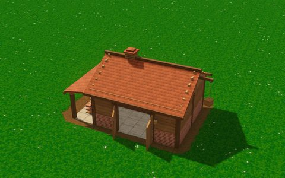

A big storage hall holding 4500 resources of any kind; workers store and fetch inside. Can turn stored stone into bricks (a switch in its menu).

### Large stockpile

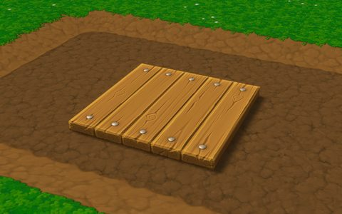

A 3 x 3 stockpile holding three times as much as the normal one.

### Tree sapling

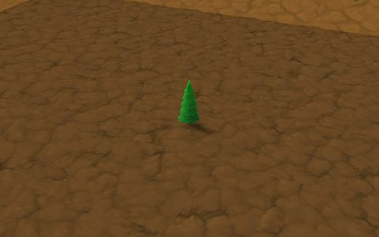

## Crafting

### Market

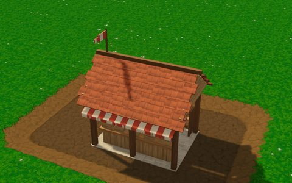

Trades any resource for another. Prices rise with trading and recover over time.

### Smithy

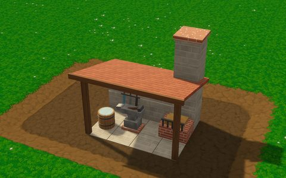

Researches weapon upgrades for the whole team: melee, block and arrow damage, archer aim and crossbow reload, in three tiers.

### Armoury

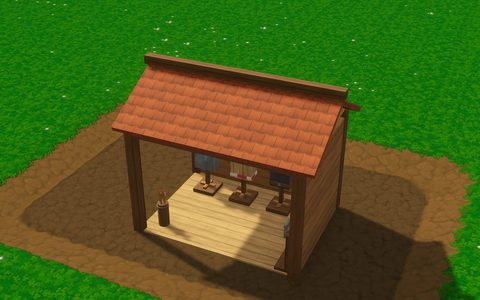

Researches armour upgrades for the soldiers: less melee, arrow and magic damage taken, more health and better shields, in three tiers.

### Research Station

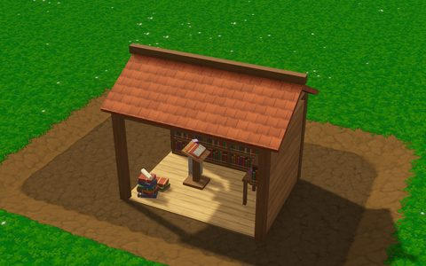

Researches colony upgrades paid in dark crystals: more bricktrons, work and walking speed, storage room, cheaper bricktrons and more.

## Standard blocks

### Tall brick 1x1x2

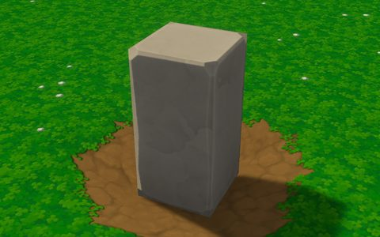

### Long brick 1x3

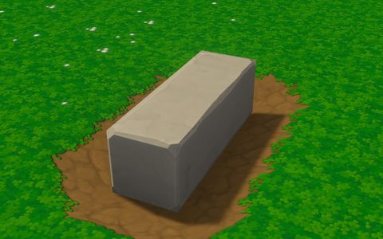

### Large brick 2x2

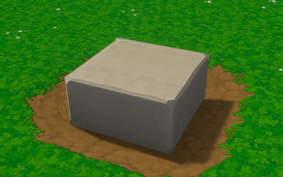

### Long brick 1x4

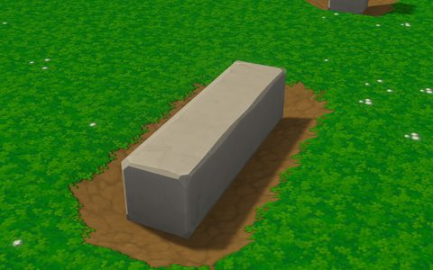

### Long brick 2x4

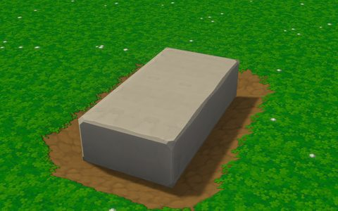

## Wood

### Wood slab 1x1

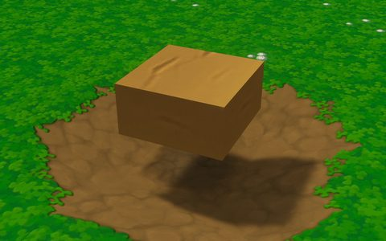

### Wood ladder

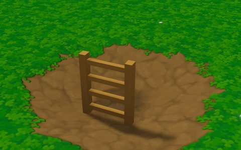

### Wood slab 2x1

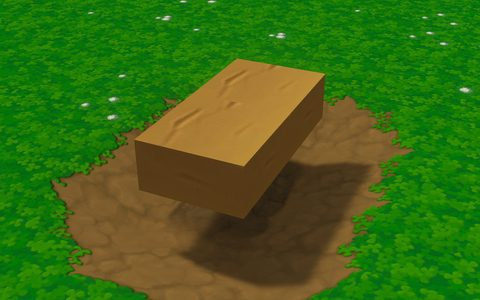

### Wood slab 1x3

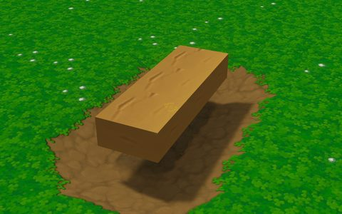

### Wood slab 2x2

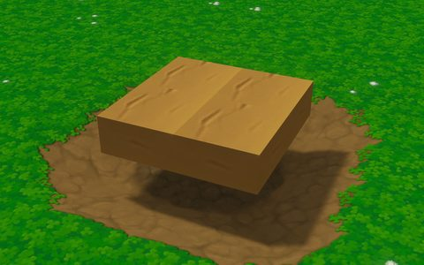

### Wood slab 1x5

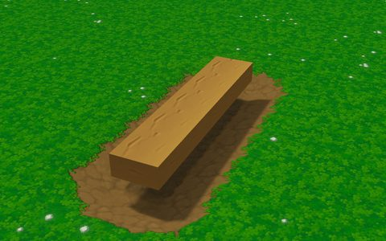

### Wood slab 2x3

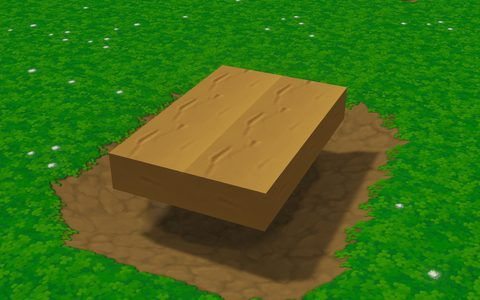

### Wood slab 2x4

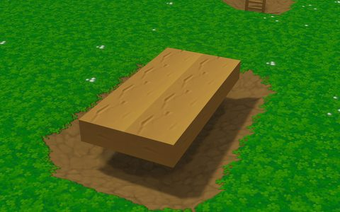

## Armour stands

Weapon stands show the kits they hold: a stand for every soldier class, full of its kits, and one with a kit of several classes (the mod's mixed stands).

|  |  |  |
|---|---|---|
| 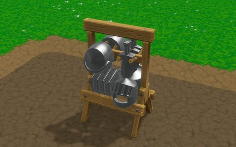 Knight | 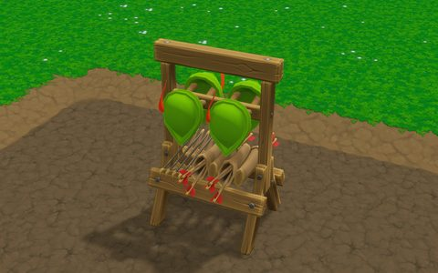 Archer | 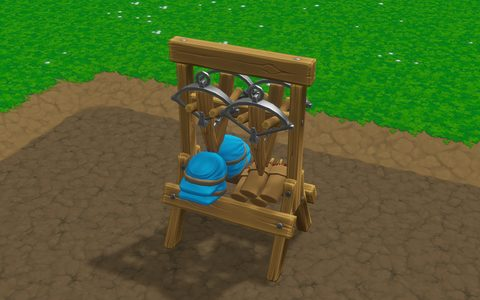 Arbalist |
| 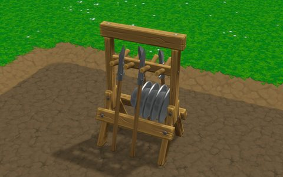 Poleaxe | 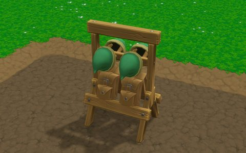 Backpack | 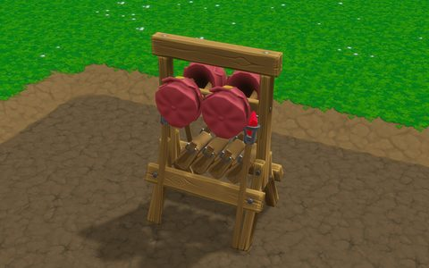 Staff |
| 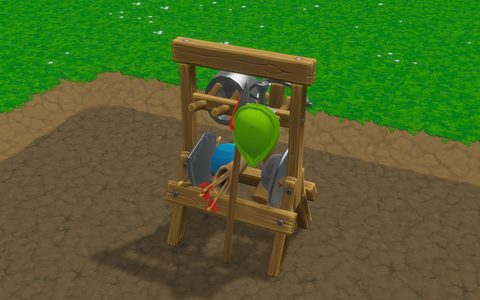 Mixed: Knight, Archer, Arbalist, Poleaxe, Backpack, Staff |  |  |

## Stockpiles

Full, at every tier of the Stacking research (0: not researched). The 3 x 3 stockpile is the mod's; on the game's 2 x 2 one the mod draws the extra layers of Stacking and its own resources (coal, steel, dark crystal), and glass and blue crystal look new.

### 2 x 2 stockpile

| Resource | Stacking 0 | Stacking 1 | Stacking 2 | Stacking 3 |
|---|---|---|---|---|
| Blue crystal | 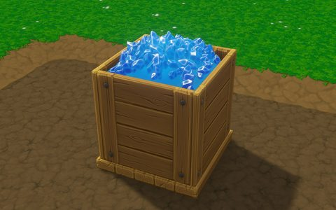 | 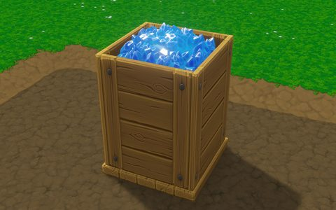 | 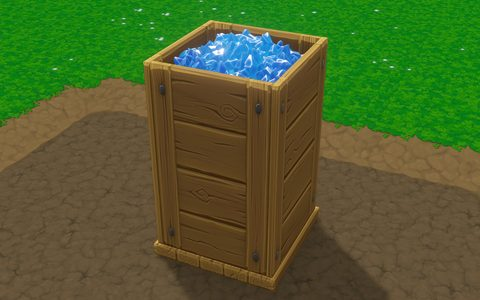 | 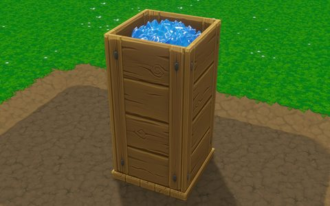 |
| Coal | 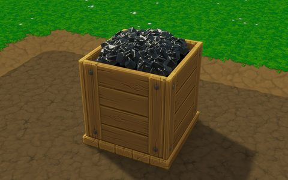 | 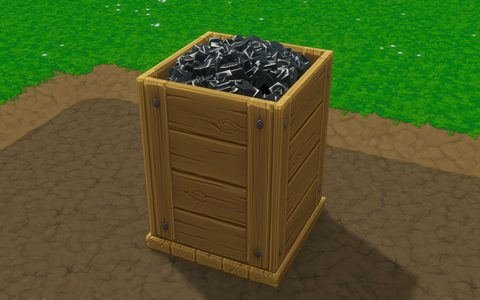 | 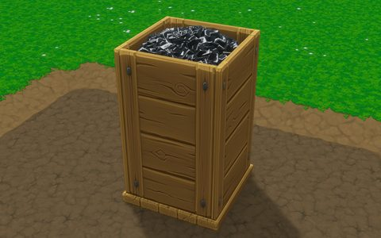 | 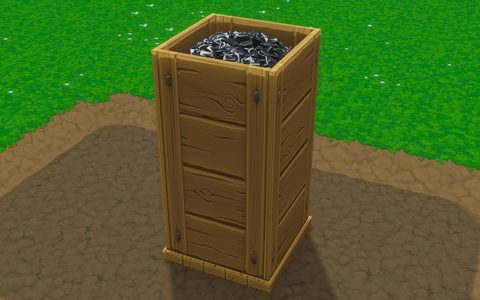 |
| Glass | 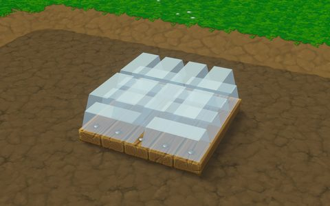 | 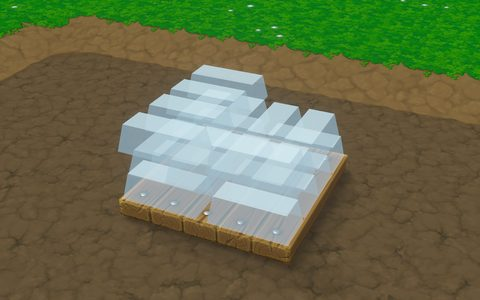 | 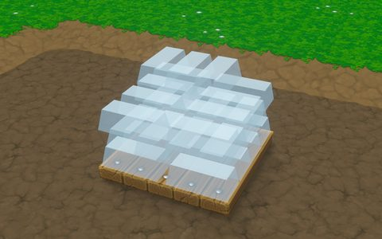 | 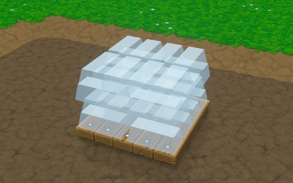 |
| Steel | 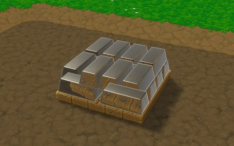 | 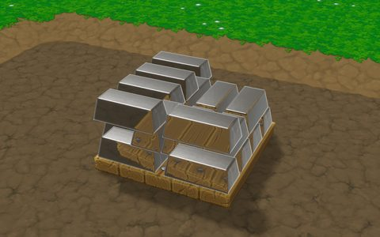 | 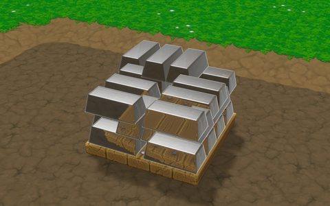 | 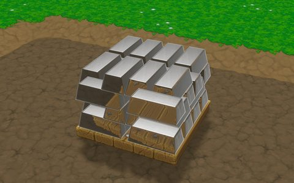 |
| Dark crystal | 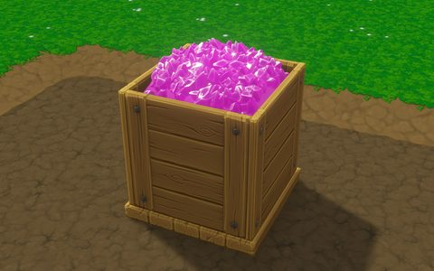 | 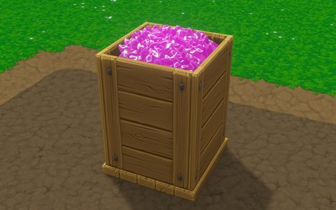 | 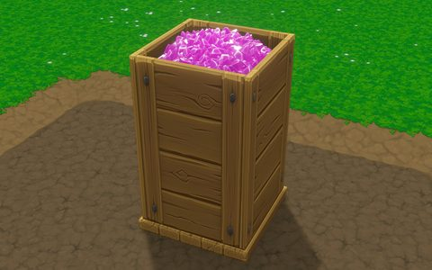 | 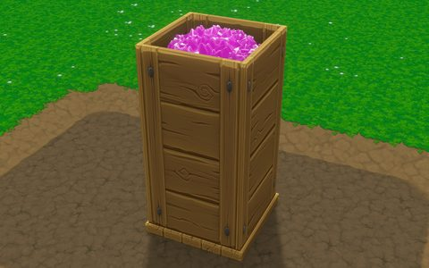 |
| Raw stone |  | 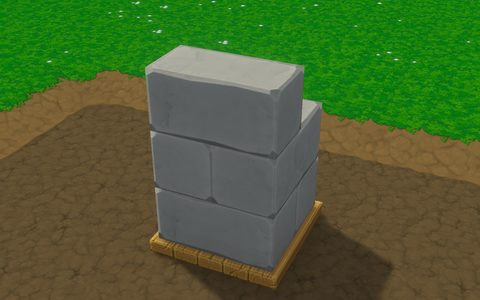 | 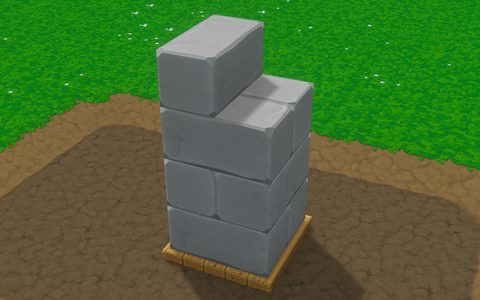 |  |
| Orange crystal |  | 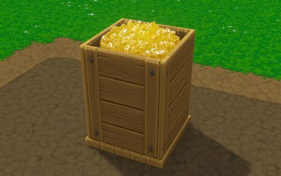 |  |  |
| Raw iron |  |  |  |  |
| Raw glass |  |  |  |  |
| Plant fibre |  |  |  |  |
| Blue crystal chunk |  |  |  |  |
| Iron |  |  |  |  |
| Fabric |  |  |  |  |
| Rope |  |  |  |  |
| Brimstone |  |  |  |  |
| Cog |  |  |  |  |
| Bomb |  |  |  |  |
| Log |  |  |  |  |
| Plank |  |  |  |  |
| Brick |  |  |  |  |

### 3 x 3 stockpile

| Resource | Stacking 0 | Stacking 1 | Stacking 2 | Stacking 3 |
|---|---|---|---|---|
| Raw stone |  |  |  |  |
| Blue crystal |  |  |  |  |
| Orange crystal |  |  |  |  |
| Raw iron |  |  |  |  |
| Raw glass |  |  |  |  |
| Plant fibre |  |  |  |  |
| Coal |  |  |  |  |
| Blue crystal chunk |  |  |  |  |
| Iron |  |  |  |  |
| Glass |  |  |  |  |
| Fabric |  |  |  |  |
| Rope |  |  |  |  |
| Brimstone |  |  |  |  |
| Steel |  |  |  |  |
| Cog |  |  |  |  |
| Bomb |  |  |  |  |
| Log |  |  |  |  |
| Plank |  |  |  |  |
| Brick |  |  |  |  |
| Dark crystal |  |  |  |  |
